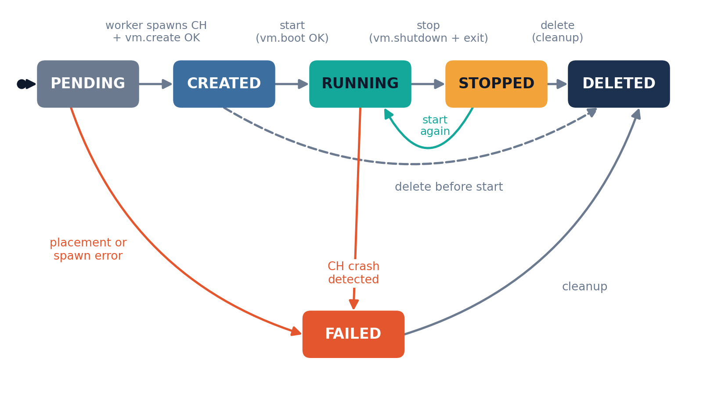

# A3-PS023-TC301

**PS-023: Minimal Two-Node Cloud Hypervisor VM Controller**
AIORI Hackathon 3 · Category: Cloud Computing

A small central controller and two worker agents that create, start, stop and list virtual machines on two KVM-capable hosts through the [Cloud Hypervisor](https://github.com/cloud-hypervisor/cloud-hypervisor) management API. VMs are placed by available host memory, bounded by enforced resource limits, and torn down cleanly so that no VM process is ever orphaned.

## Team

| Role | Name | Email |
|---|---|---|
| Team Member 1 (Faculty Mentor) | Prof. Dr. Baisakhi Das | baisakhi.das@iem.edu.in |
| Team Member 2 (Team Lead) | Debarghaya Mitra | debarghaya@debarghaya.in |
| Team Member 3 (Team Partner) | Swapnil Chakraborty | chakrabortyswapnil06@gmail.com |

Institute of Engineering and Management, Salt Lake, Kolkata.

## Documentation & Deliverables

All core architectural documents, presentation materials, and design specifications are located in the [`docs/`](docs/) and [`wiki/`](wiki/) directories:

- 📖 **[Project Wiki Documentation](wiki/Home.md)** – Comprehensive wiki covering [Architecture](wiki/System-Architecture.md), [VM Lifecycle](wiki/VM-Lifecycle-and-State-Machine.md), [API Reference](wiki/API-Reference.md), [Placement](wiki/Placement-and-Resource-Management.md), [Reliability](wiki/Reliability-and-Zero-Orphan-Guarantee.md), and [Testing/Demo](wiki/Development-Testing-and-Demo.md).
- 📄 **[PS-023: Problem Understanding & Proposed Solution](docs/PS-023-Understanding-and-Proposed-Solution.md)** – Comprehensive technical specification covering the problem breakdown, literature review, state machine design, two-tier API contracts, placement algorithms, failure handling, and pseudocode.
- 📑 **[Technical Report (PDF)](docs/A3-PS023-TC301.pdf)** – Formal hackathon submission technical report following the prescribed hackathon structure.
- 📊 **[Hackathon Presentation Deck (PPTX)](docs/A3-PS023-TC301.pptx)** – Executive presentation slides for evaluation and defense.
- 🗺️ **Architecture & Lifecycle Diagrams**:
  - [System Architecture Diagram](docs/images/architecture.png)
  - [VM Lifecycle State Machine](docs/images/vm-lifecycle.png)
  - [Comprehensive State Transition Graph](docs/images/states.png)
  - [End-to-End Data Flow Diagram](docs/images/data-flow-diagram.png)

## Problem in brief

Enterprise hypervisor stacks rely on multi-daemon architectures whose overhead is too high for lightweight edge deployments. Cloud Hypervisor boots one VM per process on Linux KVM with a minimal footprint, but it has no notion of a cluster. This project is the thinnest layer that turns two KVM hosts into a tiny cloud.

**Requirements covered**

- 2 `/dev/kvm`-capable hosts with preconfigured networking, and 1 prepared VM image
- Controller plus 2 worker agents
- VM create, start, stop and list
- Authenticated controller-to-worker API communication
- Simple placement based on available memory
- Enforced VM resource limits
- API-failure handling and cleanup of VM processes without leaks

**Out of scope:** live migration, distributed storage, browser VNC, an image marketplace, a new hypervisor.

## Architecture


| Component | Responsibility |
|---|---|
| **Controller** | Authenticated operator API, SQLite inventory, memory-based placement, periodic reconciler |
| **Worker agent** (one per host) | Spawns `cloud-hypervisor` in its own cgroup, drives [`vm.create`](https://github.com/cloud-hypervisor/cloud-hypervisor/blob/main/docs/api.md#put-apiv1vmcreate), [`vm.boot`](https://github.com/cloud-hypervisor/cloud-hypervisor/blob/main/docs/api.md#put-apiv1vmboot), [`vm.shutdown`](https://github.com/cloud-hypervisor/cloud-hypervisor/blob/main/docs/api.md#put-apiv1vmshutdown), [`vm.delete`](https://github.com/cloud-hypervisor/cloud-hypervisor/blob/main/docs/api.md#put-apiv1vmdelete), reports free memory, cleans up |
| **Cloud Hypervisor** | One process per VM, controlled over its own UNIX socket, accelerated by [`/dev/kvm`](https://docs.kernel.org/virt/kvm/api.html) |

### VM lifecycle



All operations are idempotent. Any error moves a VM to `FAILED`, followed by cleanup.

### Data flow


## Key design decisions

- **Placement.** Effective free memory is `min(MemAvailable − reserve, total − reserve − Σ guest RAM)`. The reservation is written to SQLite under a lock before the worker is called, so concurrent requests cannot overbook a host.
- **Resource limits, in three layers.** Admission control with fixed flavors, exact Cloud Hypervisor configuration (`boot_vcpus`, `memory.size`), and [Linux cgroup v2](https://docs.kernel.org/admin-guide/cgroup-v2.html) hard caps (`memory.max`, `cpu.max`, `pids.max`).
- **Authentication.** Bearer tokens ([RFC 6750](https://datatracker.ietf.org/doc/html/rfc6750)) compared in constant time over TLS 1.3 ([RFC 8446](https://datatracker.ietf.org/doc/html/rfc8446)), with separate credentials for operators and for the controller-to-worker channel.
- **No orphans.** One cgroup per VM (`cgroup.kill`), a parent-death signal (`PDEATHSIG`), write-ahead metadata, undo lists for every multi-step operation, and a reconciler that compares inventory, metadata and live processes.

## API summary

**Controller (operators)**

| Method and path | Purpose |
|---|---|
| `POST /v1/vms` | Create a VM |
| `GET /v1/vms` | List VMs |
| `POST /v1/vms/{id}/start` | Start |
| `POST /v1/vms/{id}/stop` | Stop |
| `DELETE /v1/vms/{id}` | Delete and clean up |
| `GET /v1/workers` | Worker health and capacity |

**Worker (controller only):** `GET /v1/capacity`, `POST /v1/vms`, `GET /v1/vms`, `POST /v1/vms/{id}/start`, `POST /v1/vms/{id}/stop`, `DELETE /v1/vms/{id}`.

All requests carry `Authorization: Bearer <token>`.

## Prerequisites (both hosts)

- Linux with [KVM](https://docs.kernel.org/virt/kvm/api.html) (`/dev/kvm` accessible) and [cgroup v2](https://docs.kernel.org/admin-guide/cgroup-v2.html)
- A [`cloud-hypervisor`](https://github.com/cloud-hypervisor/cloud-hypervisor/releases) binary (version pinned for a stable API schema)
- One prepared guest image at the same path on both hosts
- Preconfigured bridge or [TAP](https://docs.kernel.org/networking/tuntap.html) networking; the controller can reach both workers
- Workers run as root, or with `CAP_NET_ADMIN` and access to `/dev/kvm`, cgroups and the image directory

## Repository layout

```
A3-PS023-TC301/
  README.md
  docs/
    A3-PS023-TC301.pdf                     # Formal technical report (PDF)
    A3-PS023-TC301.pptx                    # Hackathon presentation deck (PPTX)
    PS-023-Understanding-and-Proposed-Solution.md # Comprehensive problem analysis & proposal
    images/                                # Architecture & lifecycle diagrams
      architecture.png
      data-flow-diagram.png
      states.png
      vm-lifecycle.png
  wiki/                                    # GitHub Wiki documentation pages
    Home.md                                # Wiki landing page
    System-Architecture.md                 # Deep dive into components & data flow
    VM-Lifecycle-and-State-Machine.md      # FSM transitions & teardown escalation
    API-Reference.md                       # Controller, Worker & CH REST schemas
    Placement-and-Resource-Management.md   # Memory algorithms & cgroup limits
    Reliability-and-Zero-Orphan-Guarantee.md # Orphan prevention & reconcilers
    Development-Testing-and-Demo.md        # Test suite, leak checker & demo script
    _Sidebar.md                            # GitHub Wiki navigation sidebar
    _Footer.md                             # GitHub Wiki footer
  controller/                              # API, auth, placement, inventory, worker client
  agent/                                   # API, supervisor, ch_client, cgroup, reconciler
  common/                                  # models, auth helpers, config
  deploy/                                  # systemd units, TLS and token setup scripts
  tests/                                   # unit, integration, failure injection
  scripts/                                 # demo.sh and the leak checker
```

## Planned usage

The commands below show the intended interface once the services are in place.

```bash
# on each host: start the worker agent
hvagent --listen 0.0.0.0:8443 --token-file /etc/hv/worker.token

# on the controller host
hvctl-server --workers host1:8443,host2:8443 --token-file /etc/hv/api.token

# create, start, list, stop
curl -H "Authorization: Bearer $API_TOKEN" -X POST https://controller:8443/v1/vms \
     -d '{"name":"demo","flavor":"small"}'
curl -H "Authorization: Bearer $API_TOKEN" -X POST https://controller:8443/v1/vms/<id>/start
curl -H "Authorization: Bearer $API_TOKEN" https://controller:8443/v1/vms
curl -H "Authorization: Bearer $API_TOKEN" -X POST https://controller:8443/v1/vms/<id>/stop
```

## Testing

- **Unit (no KVM needed):** placement, validation, authentication, state machine, a fake Cloud Hypervisor socket.
- **Integration:** full VM lifecycle, and two-host placement (fill Host 1, spill to Host 2, reject an oversize VM).
- **Failure injection:** `kill -9` of a Cloud Hypervisor process or the agent, a blocked worker port, a controller stopped mid-create.
- **Leak check after every test:** no stray processes, cgroups, sockets or disk files.

## Demonstration (5–7 minutes)

1. Both workers healthy; two VMs placed by memory
2. Both VMs started (serial output or ping)
3. A VM too large for either host is rejected
4. A Cloud Hypervisor process is killed; the VM shows `FAILED` and its memory is returned
5. Everything stopped and deleted; the leak check shows a clean system

## Project status and timeline

This repository starts from the design and proposal stage. Planned build order: single-host agent, then controller, then reconciler, then tests, report and demo, with a leak check at the end of every milestone.

| Date | Hackathon milestone |
|---|---|
| 14 Oct | Level 1 steps 1–7 complete |
| 16 Oct | Level 2 teams announced |
| 16–31 Oct | Mentoring sessions and steps 8–10 |
| 31 Oct – 4 Nov | Evaluators connect with teams |
| 5 Nov | Regional hackathon teams announced |
| 24–30 Nov | Regional hackathon (Bengaluru, Pune, Kolkata, Noida) |
| 17 Dec | Finals, IIT Jammu |

## References & External Documentation

### Project Deliverables
- [PS-023: Problem Understanding & Proposed Solution](docs/PS-023-Understanding-and-Proposed-Solution.md) – In-depth problem analysis, architectural design, state transitions, API schemas, and failure recovery.
- [Technical Report (PDF)](docs/A3-PS023-TC301.pdf) – Official hackathon technical report.
- [Presentation Deck (PPTX)](docs/A3-PS023-TC301.pptx) – Hackathon slide deck for evaluation and demo.

### Hypervisor & Virtualization
1. **Cloud Hypervisor Documentation Hub**: [cloud-hypervisor/docs](https://github.com/cloud-hypervisor/cloud-hypervisor/tree/main/docs) – Official user guides, architecture overview, and deployment patterns.
2. **Cloud Hypervisor REST API Reference**: [Cloud Hypervisor API Documentation](https://github.com/cloud-hypervisor/cloud-hypervisor/blob/main/docs/api.md) – REST endpoints for `vm.create`, `vm.boot`, `vm.shutdown`, `vm.delete`, `vmm.shutdown`, and `vmm.ping`.
3. **Cloud Hypervisor Architecture**: [Cloud Hypervisor Architecture Guide](https://github.com/cloud-hypervisor/cloud-hypervisor/blob/main/docs/architecture.md) – Process-per-VM design, vCPU threads, memory mapping, and device model.
4. **Linux Kernel KVM Documentation**: [Linux KVM API](https://docs.kernel.org/virt/kvm/api.html) – The `/dev/kvm` ioctl interface and hardware virtualization subsystem.
5. **KVM Original Paper**: Avi Kivity et al., [*kvm: the Linux Virtual Machine Monitor*](https://www.kernel.org/doc/ols/2007/ols2007v1-pages-225-230.pdf), Proceedings of the Linux Symposium, 2007.
6. **Firecracker Paper**: Alexandru Agache et al., [*Firecracker: Lightweight Virtualization for Serverless Applications*](https://www.usenix.org/conference/nsdi20/presentation/agache), USENIX NSDI, 2020.

### Linux Isolation, Networking & Resource Control
7. **Linux Kernel cgroup v2**: [Control Group v2 Documentation](https://docs.kernel.org/admin-guide/cgroup-v2.html) – Memory caps (`memory.max`), CPU quotas (`cpu.max`), and process-tree termination (`cgroup.kill`).
8. **systemd Resource Control**: [systemd.resource-control Manual](https://www.freedesktop.org/software/systemd/man/latest/systemd.resource-control.html) – Unit configuration for slices, scopes, and cgroup attributes.
9. **Linux TUN/TAP Driver**: [Universal TUN/TAP Device Driver](https://docs.kernel.org/networking/tuntap.html) – Virtual host-guest networking for bridge/TAP attachment.

### Protocols, Security & Standards
10. **Bearer Token Authentication**: Michael B. Jones, Dick Hardt, [*The OAuth 2.0 Authorization Framework: Bearer Token Usage*](https://datatracker.ietf.org/doc/html/rfc6750), RFC 6750, IETF, 2012.
11. **Transport Layer Security**: Eric Rescorla, [*The Transport Layer Security (TLS) Protocol Version 1.3*](https://datatracker.ietf.org/doc/html/rfc8446), RFC 8446, IETF, 2018.

### Implementation Tooling & Libraries
12. **FastAPI**: [FastAPI Framework Documentation](https://fastapi.tiangolo.com/) – Asynchronous Python web API framework for controller and agent endpoints.
13. **HTTPX**: [HTTPX Advanced Client: UNIX Domain Sockets](https://www.python-httpx.org/advanced/clients/#uds) – Client transport for interacting with Cloud Hypervisor over `/run/hv/vm-<id>.sock`.
14. **Uvicorn**: [Uvicorn ASGI Web Server](https://www.uvicorn.org/) – High-performance production ASGI web server.

## Repository handover

As required by the hackathon: this repository is private and named after the team, `aiori-hackathon` is added as a collaborator, and ownership is transferred to that account once the collaboration request is accepted. The formal technical report is available at [`docs/A3-PS023-TC301.pdf`](docs/A3-PS023-TC301.pdf) and the comprehensive design specification is at [`docs/PS-023-Understanding-and-Proposed-Solution.md`](docs/PS-023-Understanding-and-Proposed-Solution.md).
