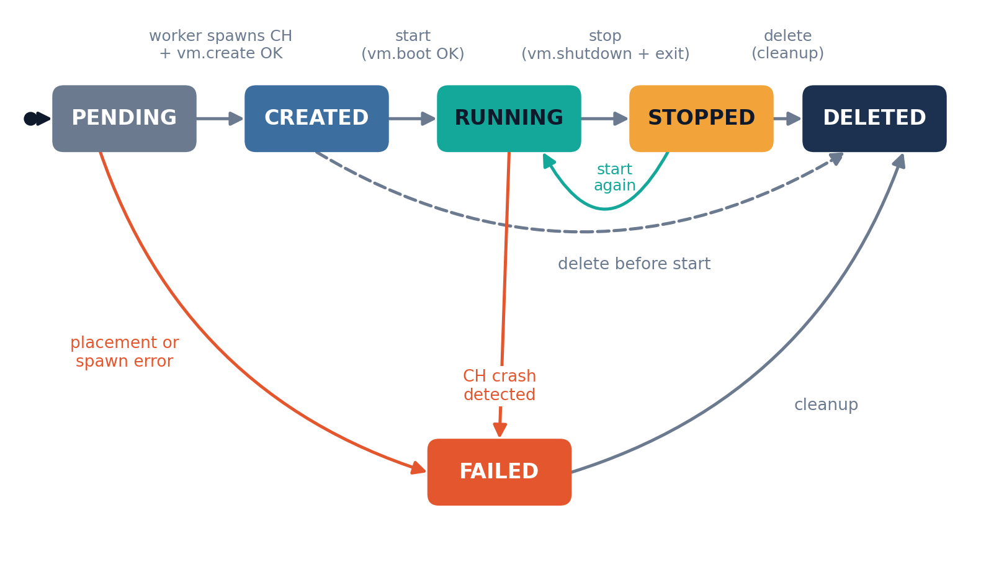
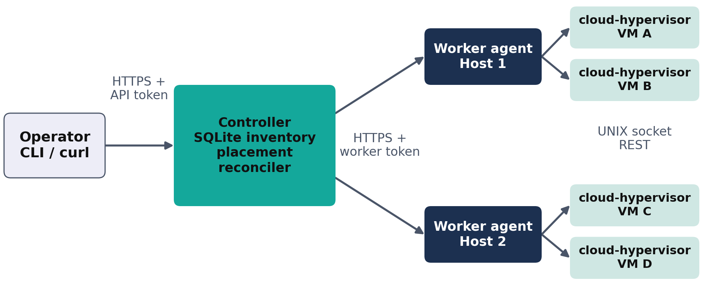
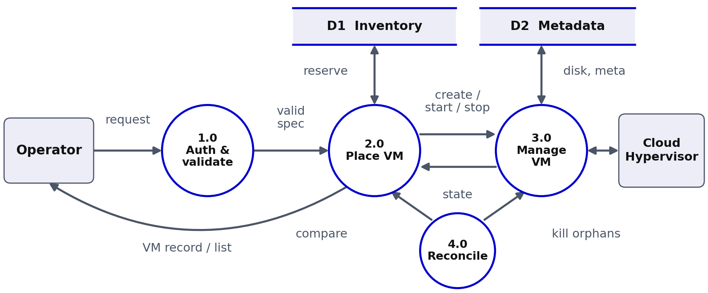

# A3-PS023-TC301: Minimal Two-Node Cloud Hypervisor VM Controller

*Problem understanding and proposed solution · AIORI Hackathon 3 · Category: Cloud Computing · October 14, 2026*

| Team member | Name | Email | Institute |
|---|---|---|---|
| Team Member 1 | Prof. Dr. Baisakhi Das | baisakhi.das@iem.edu.in | Institute of Engineering and Management, Salt Lake, Kolkata |
| Team Member 2 | Debarghaya Mitra | debarghaya@debarghaya.in | Institute of Engineering and Management, Salt Lake, Kolkata |
| Team Member 3 | Swapnil Chakraborty | chakrabortyswapnil06@gmail.com | Institute of Engineering and Management, Salt Lake, Kolkata |

Repository: <https://github.com/Swapnil-2004/A3-PS023-TC301>

This document follows the same order as the presentation deck: problem, background, understanding, literature, proposed solution, solution details, optimization, architecture, data flow, pseudocode, tests, demonstration, timeline and references.

---

## 1. Problem Description

PS-023 asks for a deliberately small virtualization control plane: **one controller and two worker agents** running on two `/dev/kvm`-capable hosts. The controller exposes an authenticated API to **create, start, stop and list** virtual machines. Each worker drives a local **Cloud Hypervisor** (CH) process through CH's own REST management API. The controller places VMs on a worker based on **available host memory**, VMs are bounded by **enforced resource limits**, and failures must never leave **orphaned VM processes**.

Enterprise virtualization stacks (OpenStack, oVirt, Proxmox, vSphere) are multi-daemon systems with message queues, databases and agents on every node. That overhead is unacceptable on small edge deployments. Cloud Hypervisor is a Rust-based VMM that runs on KVM with a small footprint and a clean REST API, but it manages **exactly one VM per process** and has no concept of a cluster. PS-023 is the thinnest possible layer that turns two such hosts into a tiny cloud.

**Key requirements from the statement**

- Use 2 `/dev/kvm`-capable hosts with preconfigured networking and 1 prepared VM image.
- Implement a controller plus 2 worker agents supporting VM create, start, stop and list.
- Use authenticated controller-to-worker API communication.
- Implement simple placement based on available memory and enforce defined VM resource limits.
- Handle API failures and clean up VM processes without leaks.
- Out of scope: live migration, distributed storage, browser VNC, an image marketplace, a new hypervisor.

## 2. Background

- **KVM** turns Linux into a hypervisor and is exposed to user space through `/dev/kvm` [6].
- **Cloud Hypervisor** is a minimal VMM on KVM. It is started as one process per VM, for example `cloud-hypervisor --api-socket path=/run/hv/vm-<id>.sock`, and is controlled through a REST API served on that UNIX socket under `/api/v1/` [1].
- Because one CH process equals one VM, "list VMs on a host" means "ask each CH process this agent supervises for `vm.info`" [1], [2].
- **Linux cgroup v2** can cap memory, CPU and process count, and `cgroup.kill` ends every process of a VM at once [5].
- **Bearer tokens over TLS** are a standard, light way to authenticate API callers [3], [4].

The management calls used in this project are listed in Section 6.1.

## 3. Understanding the Problem

### 3.1 Requirements to design

| Requirement | What it really means | Design implication |
|---|---|---|
| 2 `/dev/kvm` hosts, preconfigured networking | Hardware virtualization exists; we only consume the network | Worker verifies `/dev/kvm` at startup; use pre-made TAP devices or a bridge |
| 1 prepared VM image | Single base image, no image management | Each VM gets its own writable copy (or overlay) |
| Controller + 2 worker agents | Three processes, two hosts | Controller can be co-located on one host; workers on both |
| Create, start, stop, list | A minimal lifecycle with four verbs | Explicit state machine and idempotent operations |
| Authenticated controller→worker API | Workers must reject unauthenticated callers | Bearer token over TLS; mTLS as hardening; client auth on the controller too |
| Simple placement on available memory | Pick a host with enough free RAM | Workers report free memory; controller tracks committed memory |
| Enforce defined resource limits | Limits are enforced, not just recorded | Validate against flavors and apply cgroup caps |
| Handle API failures, clean up without leaks | Worker, CH or network may fail mid-operation | Supervision, timeouts, reconciliation loop, kill-by-cgroup |

### 3.2 Where the difficulty hides

The statement looks simple; these four points decide whether the system is truly reliable:

1. **Orphaned VMs.** If the worker crashes, `cloud-hypervisor` processes can outlive it and keep consuming RAM.
2. **Partial failures.** `vm.create` can succeed and `vm.boot` fail, leaving a created-but-unbooted VM and an allocated disk copy.
3. **Placement races.** Two concurrent create requests can both see the same free memory and overcommit a host unless the controller reserves memory atomically.
4. **State divergence.** The controller's inventory and each worker's reality can drift apart after a restart or a network partition.

### 3.3 Assumptions and non-goals

**Assumptions**

- Both hosts run Linux with KVM enabled, cgroup v2, and a `cloud-hypervisor` binary installed.
- A single prepared guest image exists at the same path on both hosts (for example `/var/lib/hv/base.raw`) together with firmware or kernel.
- Networking is preconfigured: a bridge or pre-created TAP interfaces exist, and the controller can reach both workers over IP.
- Workers run as root, or with `CAP_NET_ADMIN` plus access to `/dev/kvm`, cgroups and the image directory.

**Non-goals** (from the statement): live migration, distributed storage, browser VNC, an image marketplace, a new hypervisor. Our own additional non-goals: HA controller, multi-tenant RBAC, dynamic CPU overcommit.

## 4. Literature & RFC Review

| Source | Key idea | Used in our design |
|---|---|---|
| [1] Cloud Hypervisor API | REST over a UNIX socket: `vm.create`, `vm.boot`, `vm.shutdown`, `vm.delete` | Worker lifecycle integration |
| [2] Firecracker (NSDI 2020) | Minimal VMM; one process and one API socket per micro-VM | Process-per-VM supervision |
| [3] RFC 6750 | Bearer tokens in the `Authorization` header | Controller and worker API authentication |
| [4] RFC 8446 | TLS 1.3 protects credentials in transit | Encrypted controller-worker link |
| [5] Linux cgroup v2 | `memory.max`, `cpu.max`, `pids.max`, `cgroup.kill` | Resource limits and leak-free teardown |
| [6] KVM | In-kernel hypervisor exposed as `/dev/kvm` | Hardware virtualization on both hosts |

## 5. Proposed Solution

One controller, two worker agents, one Cloud Hypervisor process per VM.

**Controller (`hvctl-server`)**

- Public REST API for operators, protected by an API token.
- Inventory store in SQLite: workers, VMs, state, host assignment, reserved memory.
- Placement engine and a periodic reconciler that compares inventory with worker reports.
- Worker client with timeouts, retries on idempotent calls and request IDs.

**Worker agent (`hvagent`)**

- Internal REST API, reachable only by the controller, protected by a separate credential.
- Process supervisor: spawns `cloud-hypervisor`, tracks PIDs, creates a cgroup per VM, reaps children.
- Thin CH client that speaks HTTP over a UNIX socket.
- Resource reporter: total, available and committed memory, running VM count.
- Local state directory `/var/lib/hvagent/vms/<id>/` holding the disk copy, metadata JSON, socket and logs.

**Cloud Hypervisor processes**: one per VM, started on demand by the agent, each with its own API socket and cgroup.

**Technology choice.** Python 3.11 with FastAPI for both services is the fastest path to a working prototype: `httpx` supports UNIX-socket transport for the CH API, `subprocess` and `os` cover process control, and `pytest` covers testing. Go is a strong alternative (single static binary, easy cgroup and process handling). The design is language-neutral.

### 5.1 VM lifecycle and state machine



- **create**: reserves memory on a chosen worker, prepares the disk, spawns CH and calls `vm.create`. The VM is defined but not booted.
- **start**: calls `vm.boot`; if the CH process is gone (after a stop), the agent respawns it and recreates the VM from stored metadata first.
- **stop**: graceful `vm.shutdown` with a timeout, then `vm.delete`, `vmm.shutdown`, and finally SIGKILL of the whole cgroup if the process is still alive. Memory reservation is released only after the process is confirmed gone.
- **list**: the controller returns inventory merged with live worker status.
- **delete** (recommended extra): removes the disk copy, cgroup and metadata, so the list does not grow with dead entries and disk does not leak.

All operations are **idempotent**: stopping a stopped VM or starting a running VM returns success with the current state.

## 6. Solution Details

### 6.1 Cloud Hypervisor integration

One CH process equals one VM. The calls used (all under `/api/v1/` on the VM's UNIX socket):

| Endpoint | Method | Purpose |
|---|---|---|
| `vmm.ping` | GET | Health and version check of the VMM process |
| `vm.create` | PUT | Define the VM (CPUs, memory, payload, disks, network) without booting |
| `vm.boot` | PUT | Boot a created VM |
| `vm.info` | GET | Return configuration and state (Created, Running, Shutdown, Paused) |
| `vm.shutdown` | PUT | Stop the guest |
| `vm.delete` | PUT | Delete the VM definition |
| `vmm.shutdown` | PUT | Terminate the VMM process itself |

A representative `vm.create` body contains `cpus` (`boot_vcpus`, `max_vcpus`), `memory` (`size` in bytes), `payload` (kernel or firmware path and command line), `disks` (list with `path`), `net` (list with `tap` and `mac`) and `serial`/`console` settings. The exact schema should be confirmed against the CH `docs/api.md` and the version installed on the hosts.

### 6.2 Two small APIs

**Controller API (operator-facing)**

| Method and path | Description |
|---|---|
| `POST /v1/vms` | Create a VM. Body: `name`, `flavor` or explicit `vcpus` and `memory_mib` |
| `GET /v1/vms` | List all VMs with state and host |
| `GET /v1/vms/{id}` | Get one VM |
| `POST /v1/vms/{id}/start` | Start |
| `POST /v1/vms/{id}/stop` | Stop |
| `DELETE /v1/vms/{id}` | Delete and clean up |
| `GET /v1/workers` | Worker health, total, available and committed memory |
| `GET /healthz` | Liveness |

**Worker API (controller-facing)**

| Method and path | Description |
|---|---|
| `GET /v1/capacity` | `total_mib`, `available_mib`, `committed_mib`, `vm_count` |
| `POST /v1/vms` | Prepare and define a VM (spawn CH, `vm.create`) |
| `POST /v1/vms/{id}/start` | `vm.boot` |
| `POST /v1/vms/{id}/stop` | Graceful stop then forced cleanup |
| `DELETE /v1/vms/{id}` | Remove everything |
| `GET /v1/vms` | Locally known VMs with live `vm.info` state |

**Authentication.** The minimum satisfying the statement is a per-tier shared secret sent as `Authorization: Bearer <token>`, compared in constant time, with TLS protecting it [3], [4]. A stronger and still small option is HMAC-signed requests (timestamp, method, path and body hash) to prevent replay, or mutual TLS using a private CA. Recommendation: bearer plus TLS first, mTLS as the hardening path, and CH sockets mode `0600` owned by the agent so that local users cannot bypass the API.

### 6.3 Memory-based placement

**Goal:** choose a worker with enough memory for the requested VM, with minimal complexity and no overcommit.

**Effective free memory:**

`free_effective = min(MemAvailable − host_reserve, total − host_reserve − Σ guest_memory of all non-deleted VMs)`

Taking the minimum of the "real" and the "committed" view protects against stale readings and lazily-faulted guest memory (host reserve, for example 512 MiB).

**Algorithm (best-fit by default, worst-fit as an option):**

1. Query `/v1/capacity` from each healthy worker (timeout 2 s).
2. Filter out workers with `free_effective < requested`.
3. If none remain, return a clear error (for example `409`) with the per-worker free values.
4. Choose the worker with the **most** free memory (spreads load) or the **least** sufficient free memory (packs tightly). Tie-break by lower VM count, then by name.
5. Insert the VM row with `reserved_mib` and `state=PENDING` inside one SQLite transaction guarded by a controller-wide lock, so concurrent requests cannot double-book.
6. Call the worker; on failure, release the reservation and optionally retry on the other worker once.

### 6.4 Three layers of resource limits

1. **Admission control (controller and worker).** Only allow vCPUs and memory within bounds, for example a fixed set of flavors: `small` 1 vCPU/512 MiB, `medium` 2 vCPU/1 GiB, `large` 4 vCPU/2 GiB. Reject anything else with `422`. The worker re-validates so it never trusts the controller blindly.
2. **Hypervisor configuration.** Pass `boot_vcpus` equal to `max_vcpus` and `memory.size` exactly as granted to `vm.create`.
3. **Host-level hard caps via cgroup v2 [5].** Place each CH process in `/sys/fs/cgroup/hvagent/<vm-id>/` and set `memory.max` to guest memory plus VMM overhead (for example +128 MiB), `cpu.max` to `vcpus × 100000 100000`, and `pids.max` to a small number. If the VMM leaks or is compromised, the kernel enforces the ceiling.

Disk is bounded by creating each VM disk as a per-VM copy (`cp --reflink=auto`) of the fixed-size base image, and by refusing creation when the data partition is below a free-space threshold.

### 6.5 Failure handling

| Failure | Detection | Response |
|---|---|---|
| CH fails to start | Socket not ready within N seconds, or process exits | Kill cgroup, delete disk copy, mark `FAILED`, release reservation |
| `vm.create` or `vm.boot` error | HTTP status from CH | Roll back through the undo list; if `create` failed, full cleanup |
| Graceful shutdown hangs | Timeout waiting for state `Shutdown` | Escalate: `vmm.shutdown`, SIGTERM, then `cgroup.kill` |
| Worker unreachable | Request timeout or connection error | Mark worker `UNHEALTHY` after K failures; no new placements; VMs shown as `UNKNOWN` |
| Controller crash mid-create | Rows left in `PENDING` | On restart, reconciler asks workers what exists and adopts or deletes |
| Agent crash or restart | Agent restarts with VMs possibly running | Startup reconciliation: scan `meta.json` files, check PIDs and sockets, adopt healthy VMs, kill anything unknown |
| CH process dies unexpectedly | `waitpid` or periodic `vm.info`/PID probe | Mark `FAILED`, release memory, clean socket |

### 6.6 No orphans, by construction

- **Dedicated cgroup per VM.** `cgroup.kill` ends every descendant; nothing escapes by double-forking.
- **Parent-death signal.** Spawn CH with `prctl(PR_SET_PDEATHSIG, SIGKILL)` so VMs die if the agent dies (the alternative, systemd transient scopes plus adoption logic, is documented but not our default). "Agent death kills its VMs, then restart reconciles the leftovers" is the simplest and safest story for the demo.
- **Own process group and signal handlers.** The agent stops all VMs in order on SIGTERM and SIGINT.
- **Write-ahead metadata.** `meta.json` is written before spawning, so crash recovery knows what to clean.
- **Periodic reconciler (every 10–30 s).** Compares controller inventory, agent metadata and actual processes: unknown process → kill; known `RUNNING` VM without a process → mark `FAILED`; leftover disk without metadata → delete.
- **Bounded timeouts and undo lists.** Every call has a timeout and a retry budget; every multi-step operation has an explicit undo list.

## 7. Optimization Proposed

| Aspect | Before: naive approach | After: proposed optimization |
|---|---|---|
| Placement | Read `MemAvailable` only; races overcommit | `min(real, committed)` plus a reservation lock |
| Teardown | Kill stored PID; children can leak | `cgroup.kill`, death signal and reconciler |
| Limits | Recorded only, not enforced | Flavors, CH config and cgroup v2 caps |
| Disk | Full image copy per VM | Reflink copy (`cp --reflink=auto`) |
| Failures | Ad-hoc error handling | Undo list and rollback per operation |

## 8. Solution Architecture & Design

The operator talks to the controller over HTTPS with an API token. The controller talks to the worker agent on each host over HTTPS with a worker token. Each agent runs its `cloud-hypervisor` processes and controls them over UNIX sockets; the VMs are accelerated by `/dev/kvm`. The controller may run on Host 1 for the demonstration, which still satisfies "controller plus two workers across two hosts".



## 9. Data Flow Diagram



| Element | Role |
|---|---|
| Operator (external) | Sends VM requests with an API token and receives VM records or list results |
| 1.0 Auth & validate | Authenticates the caller and validates the request against allowed sizes |
| 2.0 Place VM | Computes effective free memory, picks a host, reserves memory in D1, calls the worker |
| 3.0 Manage VM (worker) | Spawns CH, applies cgroup limits, writes D2, calls `vm.create`, `vm.boot`, `vm.shutdown`, reports state and capacity |
| 4.0 Reconcile | Compares inventory with reality; kills orphans and marks failures |
| D1 Inventory | SQLite: VMs, states, hosts, reserved memory |
| D2 Metadata | Per-VM `meta.json` and disk copy on the worker |
| Cloud Hypervisor (external) | The VMM process reached over its UNIX socket |

## 10. Pseudocode

The statement requires a prototype demonstration with a pseudocode snippet. The following captures the heart of the system.

**Controller: create VM**

```
function create_vm(request):
    authenticate(request)
    spec = validate_and_normalize(request)          # flavor, vcpus, memory_mib
    with placement_lock:
        candidates = []
        for w in workers where w.healthy:
            cap = w.get_capacity(timeout=2s)
            free = min(cap.available - HOST_RESERVE,
                       cap.total - HOST_RESERVE - db.sum_reserved(w))
            if free >= spec.memory_mib: candidates.append((w, free))
        if candidates is empty: raise InsufficientCapacity(report(cap per worker))
        worker = argmax(candidates, key=free)       # tie-break: fewer VMs
        vm = db.insert(spec, worker, state=PENDING, reserved=spec.memory_mib)
    try:
        result = worker.post("/v1/vms", {id: vm.id, spec: spec})
        db.update(vm, state=CREATED)
    except Error:
        worker.try_delete(vm.id)                    # best effort rollback
        db.update(vm, state=FAILED, reserved=0)
        raise
    return vm
```

**Worker: spawn and define a VM**

```
function agent_create(id, spec):
    assert within_limits(spec)
    write_meta(id, spec, status="creating")         # write-ahead record
    undo = []
    try:
        disk = reflink_copy(BASE_IMAGE, vm_dir(id)/"disk.raw");  undo.push(delete(disk))
        cg = make_cgroup(id, mem_max=spec.mem+OVERHEAD, cpu_max=spec.vcpus*100%)
        undo.push(kill_and_remove(cg))
        proc = spawn("cloud-hypervisor --api-socket path=" + sock(id), in_cgroup=cg,
                     pdeathsig=SIGKILL)
        wait_until(ch.ping(sock(id)) ok, timeout=5s)
        ch.put(sock(id), "vm.create", build_ch_config(spec, disk, tap_for(id)))
        write_meta(id, status="created", pid=proc.pid)
    except any:
        run_in_reverse(undo)
        remove_meta(id)
        raise
```

**Worker: stop with guaranteed cleanup**

```
function agent_stop(id):
    if not process_alive(id): return "stopped"      # idempotent
    try: ch.put(sock(id), "vm.shutdown"); wait_state("Shutdown", timeout=10s)
    except: pass
    try: ch.put(sock(id), "vm.delete"); ch.put(sock(id), "vmm.shutdown")
    except: pass
    if not wait_exit(pid, timeout=5s): cgroup_kill(id)   # kills everything
    assert cgroup_empty(id)
    release_memory(id); write_meta(id, status="stopped")
```

**Reconciler loop (both tiers)**

```
every 15s:
    actual = scan_processes_and_cgroups()
    known  = read_all_meta()
    for p in actual - known:  cgroup_kill(p)                       # orphan
    for v in known where v.status == "running" and v not in actual:
        mark_failed(v); release_memory(v)
    for d in disk_dirs - known: remove(d)                          # leaked files
```

## 11. Test Strategy

**Unit tests (no KVM needed)**

- Placement: enough memory on one host, on both, on neither; tie-breaking; reservation accounting; concurrent requests do not overbook.
- Validation: out-of-range vCPUs and memory are rejected; unknown flavors rejected.
- Auth: missing, wrong and valid tokens on both APIs.
- State machine: all legal and illegal transitions; idempotent start and stop.
- CH client against a fake UNIX-socket server returning canned CH responses and errors.

**Integration tests on real hosts**

1. **Lifecycle:** create → list shows `CREATED` → start → guest reachable (ping or serial log) → stop → list shows `STOPPED` → delete → no process, cgroup, socket or disk remains.
2. **Two-host placement:** create VMs until Host 1 is full and verify the next lands on Host 2; stop one VM and verify the freed memory is reusable; request more memory than either host has and verify a clean rejection.
3. **Resource limits:** attempt an oversize VM (rejected); run a memory stress in a guest and verify the cgroup caps the VMM; check the `cpu.max` effect with a CPU burner.
4. **Failure injection:** `kill -9` the CH process (state becomes `FAILED`, memory released); `kill -9` the agent (VMs die or are adopted per policy, no orphans after restart); block the controller→worker port (worker marked unhealthy); kill the controller mid-create (reconciler cleans `PENDING`).
5. **Leak check after every test:** `pgrep cloud-hypervisor` count, cgroup directory, `/run/hv` sockets and disk directory all match the inventory.

## 12. Demonstration and Deliverables

**Live demo (5–7 minutes)**

1. Show both workers healthy (`GET /v1/workers`) and create two VMs placed by memory.
2. Start both; show serial output or a ping.
3. Request a VM too large for either host and show the clear rejection.
4. Kill a CH process manually; show `FAILED` state and memory being released.
5. Stop and delete everything; run the leak check to show zero leftover processes, cgroups, sockets and disks.
6. Walk through the placement and cleanup pseudocode.

**Deliverables required by the statement**

- Create a private repository named after the team (`A3-PS023-TC301`) and add `aiori-hackathon` as a collaborator; after acceptance, transfer ownership to that account.
- Upload the PDF report to the repository, following `Proposed-structure-hackathon.pdf`.
- Prototype demonstration with a pseudocode snippet to the mentor.

**Suggested repository structure**

```
A3-PS023-TC301/
  README.md                 # quick start and demo script
  docs/Technical-Report.pdf # follows Proposed-structure-hackathon.pdf
  controller/               # API, auth, placement, inventory, worker client
  agent/                    # API, supervisor, ch_client, cgroup, reconciler
  common/                   # models, auth helpers, config
  deploy/                   # systemd units, TLS/token setup scripts
  tests/unit  tests/integration  tests/failure
  scripts/demo.sh
```

## 13. Deployment Timeline

**Official hackathon milestones**

| # | Milestone | Date |
|---|---|---|
| 1 | Complete Level 1 steps 1–7 (qualifies for the Level 2 certificate) | 14 Oct |
| 2 | Level 2 teams announced | 16 Oct |
| 3 | Mentoring sessions (2 per problem category) and steps 8–10 | 16–31 Oct |
| 4 | Evaluators connect with teams (not all teams may be connected) | 31 Oct – 4 Nov |
| 5 | Regional hackathon teams announced | 5 Nov |
| 6 | Regional hackathon (max. 20 teams per region): Bengaluru, Pune, Kolkata, Noida | 24–30 Nov |
| 7 | Finals (8 teams), IIT Jammu | 17 Dec |

**Our build plan inside the 16–31 Oct mentoring window**

| Phase | Work | Output |
|---|---|---|
| 1 | Manually boot a VM with CH on one host and drive it with `curl --unix-socket` | Known-good CH config and network setup |
| 2 | Build the agent: spawn, cgroup, `vm.create/boot/shutdown/delete`, capacity | Working single-host agent |
| 3 | Build the controller: inventory, auth, placement, worker client | End-to-end on two hosts |
| 4 | Reconciler, failure handling, rollback | Leak-free behaviour |
| 5 | Tests and failure injection | Test suite and leak checker |
| 6 | Report, diagrams, demo rehearsal, GitHub transfer | Final deliverables |

Every milestone ends with a leak check on both hosts, and the Cloud Hypervisor version is pinned so the API schema stays stable.

**Risks and mitigations**

| Risk | Mitigation |
|---|---|
| CH API schema differs by version | Pin the CH version, test with it, keep the config builder in one module |
| No nested KVM on the test machines | Verify `/dev/kvm` early; fall back to physical hosts or a cloud instance with nested virtualization |
| Network setup consumes time | Use a pre-made bridge and static TAP names per VM slot; use static guest IPs or the serial console |
| Orphaned processes during development | Always run through the cgroup/`PDEATHSIG` path and keep the leak-check script handy |
| Scope creep (migration, VNC, image upload) | Keep the non-goals list visible and refuse additions until all required items pass tests |

## 14. Conclusion

The project is small in surface area but rich in systems-engineering concerns: lifecycle correctness, authentication, honest resource accounting and guaranteed cleanup. The proposed design keeps every moving part minimal, one controller, two agents, one CH process per VM, while using the right kernel primitives (cgroup v2, process-death signals, per-VM sockets) to make leaks practically impossible. A reconciler turns every crash scenario into a recoverable one, and the test plan proves each requirement from the problem statement.

## Bibliography

1. Cloud Hypervisor Project. "Cloud Hypervisor REST API documentation." GitHub, `docs/api.md`. <https://github.com/cloud-hypervisor/cloud-hypervisor/blob/main/docs/api.md>
2. Alexandru Agache et al. "Firecracker: Lightweight Virtualization for Serverless Applications." In: *Proc. USENIX NSDI* (2020).
3. Michael B. Jones and Dick Hardt. "The OAuth 2.0 Authorization Framework: Bearer Token Usage." RFC 6750, IETF (2012).
4. Eric Rescorla. "The Transport Layer Security (TLS) Protocol Version 1.3." RFC 8446, IETF (2018).
5. The Linux Kernel Documentation. "Control Group v2." <https://docs.kernel.org/admin-guide/cgroup-v2.html>
6. Avi Kivity et al. "kvm: the Linux Virtual Machine Monitor." In: *Proceedings of the Linux Symposium* (2007).
