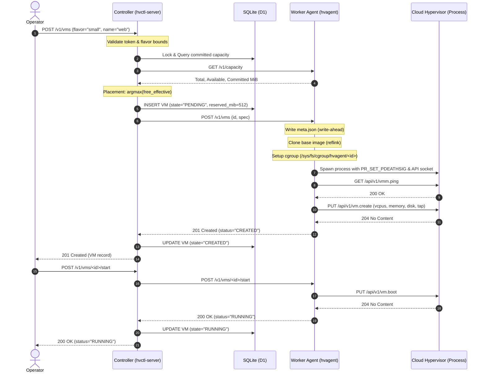

# System Architecture & Design

This page provides an architectural breakdown of the **Minimal Two-Node Cloud Hypervisor VM Controller**, explaining the component layers, process boundaries, data flows, and storage layouts.

---

## 1. Physical & Logical Topology

The system coordinates two physical or virtual Linux hosts equipped with hardware virtualization (`/dev/kvm`) and Linux cgroup v2.

```
+---------------------------------------------------------------------------------------+
| HOST 1                                                                                |
|                                                                                       |
|  +---------------------------+        +--------------------------------------------+  |
|  | Controller (hvctl-server) |        | Worker Agent 1 (hvagent)                   |  |
|  | - Port: 8443 (HTTPS)      |        | - Port: 8444 (HTTPS)                       |  |
|  | - Inventory: SQLite       |        | - State: /var/lib/hvagent/                 |  |
|  +-------------+-------------+        +---------------------+----------------------+  |
|                |                                            |                         |
|                |                                            | UNIX Domain Sockets     |
|                |                                            v                         |
|                |                      +--------------------------------------------+  |
|                |                      | Cloud Hypervisor Instances (1 per VM)      |  |
|                |                      | [CH: vm-01]  [CH: vm-02]                   |  |
|                |                      +--------------------------------------------+  |
+----------------+----------------------------------------------------------------------+
                 |
                 | Internal Network Link (TLS 1.3 / Bearer Auth)
                 v
+---------------------------------------------------------------------------------------+
| HOST 2                                                                                |
|                                                                                       |
|  +---------------------------------------------------------------------------------+  |
|  | Worker Agent 2 (hvagent)                                                        |  |
|  | - Port: 8444 (HTTPS)                                                            |  |
|  | - State: /var/lib/hvagent/                                                      |  |
|  +------------------------------------------+--------------------------------------+  |
|                                             |                                         |
|                                             | UNIX Domain Sockets                     |
|                                             v                                         |
|  +---------------------------------------------------------------------------------+  |
|  | Cloud Hypervisor Instances (1 per VM)                                           |  |
|  | [CH: vm-03]                                                                      |  |
|  +---------------------------------------------------------------------------------+  |
+---------------------------------------------------------------------------------------+
```

> **Topology Note:** For the hackathon deployment, the controller daemon (`hvctl-server`) is co-located on Host 1 alongside Worker Agent 1. Worker Agent 2 runs independently on Host 2. This satisfies the requirement of "one controller and two worker agents spanning two KVM hosts".

---

## 2. Core Components & Responsibilities

| Component | Binary / Daemon | Core Responsibilities |
|---|---|---|
| **Central Controller** | `hvctl-server` | <ul><li>Exposes authenticated operator REST API (`/v1/vms`, `/v1/workers`).</li><li>Maintains persistent VM and worker inventory in SQLite (`D1`).</li><li>Calculates placement based on real and committed host memory.</li><li>Runs background cluster reconciliation loop (detecting unreachable workers).</li><li>Issues authenticated requests to worker nodes.</li></ul> |
| **Worker Agent** | `hvagent` | <ul><li>Exposes internal REST API for controller commands (`/v1/capacity`, `/v1/vms`).</li><li>Supervises `cloud-hypervisor` child processes.</li><li>Creates and configures dedicated cgroup v2 directories per VM.</li><li>Manages per-VM disks (`cp --reflink=auto`) and write-ahead metadata (`meta.json`).</li><li>Communicates with Cloud Hypervisor over `/run/hvagent/vm-<id>.sock`.</li><li>Runs node-level reconciliation loop to reap orphans and detect crashes.</li></ul> |
| **Hypervisor Engine** | `cloud-hypervisor` | <ul><li>One lightweight VMM process per virtual machine.</li><li>Translates guest execution into KVM ioctls via `/dev/kvm`.</li><li>Serves internal REST API on a dedicated UNIX socket.</li><li>Provides virtio-block, virtio-net, and virtio-console virtualization.</li></ul> |

---

## 3. Data Flow Architecture

The data flow diagram below illustrates how client requests traverse the controller, update inventory, reach workers, and interact with the hypervisor process.


### Sequence of Operations: VM Provisioning & Boot



---

## 4. Storage & Filesystem Layout

### 4.1 Controller Inventory (`D1`: SQLite Database)
The controller stores metadata in `/var/lib/hvctl/inventory.db`.
- **`workers` table**: Hostname, IP, port, last heartbeat timestamp, health status (`HEALTHY`, `UNHEALTHY`).
- **`vms` table**: Unique UUID, friendly name, vCPU count, memory MiB, assigned worker ID, current state (`PENDING`, `CREATED`, `RUNNING`, `STOPPED`, `FAILED`), creation timestamp.

### 4.2 Worker Local Storage (`D2`: Filesystem Tree)
Each worker agent maintains per-VM isolation under `/var/lib/hvagent/`:

```
/var/lib/hvagent/
├── base/
│   └── focal-base.raw              # Pinned immutable base image
├── vms/
│   └── 8a6f4e12-b91c-4b5a-.../     # VM UUID directory
│       ├── disk.raw                # Reflink copy of base image
│       ├── meta.json               # Write-ahead state & configuration
│       ├── serial.log              # Guest console output log
│       └── cloud-init.iso          # Optional user-data/network-config
└── /run/hvagent/
    └── 8a6f4e12-b91c-4b5a-...sock  # Cloud Hypervisor control socket (mode 0600)
```

### 4.3 Control Groups (cgroup v2 Hierarchy)
Each VM process resides inside its own dedicated slice:

```
/sys/fs/cgroup/hvagent/
└── 8a6f4e12-b91c-4b5a-.../
    ├── cgroup.procs                # Cloud Hypervisor main PID & vCPU threads
    ├── cgroup.kill                 # Write "1" to instantly kill all processes
    ├── memory.max                  # Hard memory limit (Guest RAM + 128 MiB overhead)
    ├── cpu.max                     # vCPUs * 100000 quota
    └── pids.max                    # Max process limit (e.g., 32)
```

---

## 5. Security & Isolation Architecture

1. **API Authentication**:
   - Operator requests to Controller: Protected with HTTP Bearer token matching `/etc/hvctl/api.token`.
   - Controller requests to Workers: Protected with internal Bearer token matching `/etc/hvagent/worker.token`.
   - Constant-time string comparisons (`hmac.compare_digest`) prevent timing attack vectors.
2. **Network Transport Security**:
   - Inter-node traffic (Controller ↔ Workers) is encrypted over TLS 1.3 with mutual verification.
3. **Hypervisor Socket Isolation**:
   - The UNIX domain socket `/run/hvagent/vm-<id>.sock` is owned by `root:root` with permissions `0600`.
   - Local non-privileged users cannot access or tamper with VM sockets directly.
4. **Hardware Virtualization**:
   - VM processes execute in guest unprivileged mode via `/dev/kvm`.
   - In case of a guest kernel exploit, the host kernel cgroups immediately contain CPU, memory, and fork bombs.
